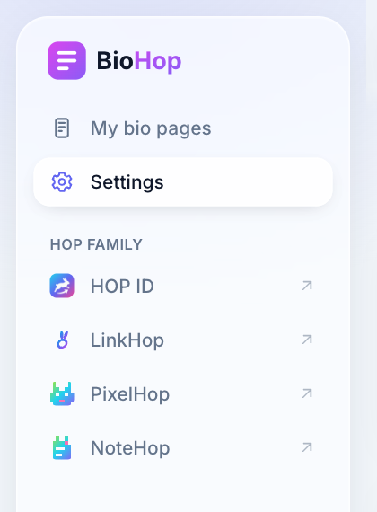
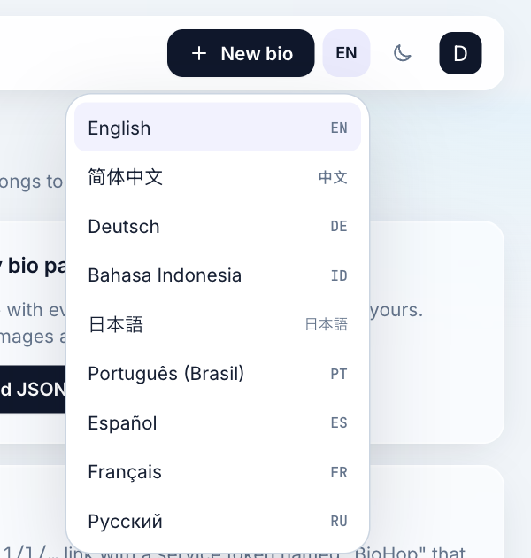
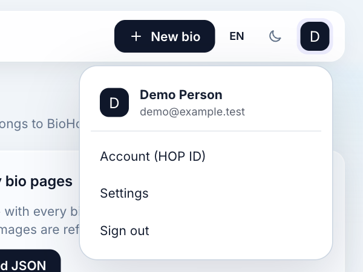
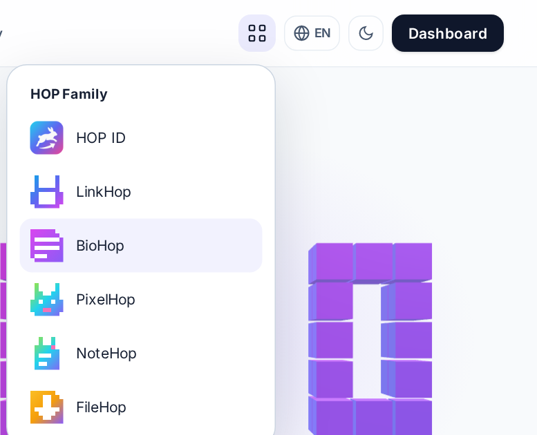

# hop/ui

[English](README.md) · [简体中文](README.zh-CN.md) · [Deutsch](README.de.md) · [Bahasa Indonesia](README.id.md) · [日本語](README.ja.md) · [Português (Brasil)](README.pt-BR.md) · [Español](README.es.md) · [Français](README.fr.md) · **Русский**

Общие Blade-компоненты и данные семейства для Laravel-приложений семейства HOP ([hel.ink](https://hel.ink)): навигация по семейству, меню языка, приложений и аккаунта, подвал, типографика и плавающие плитки, а также единый список поддерживаемых языков. Все приложения, которые его используют, в этих местах выглядят и работают одинаково.

## Скриншоты

Они сделаны в панели управления и на главной странице BioHop, запущенных локально с демо-аккаунтом, с этим пакетом из `main`.









## Требования

- PHP 8.3 и Laravel 12 (`illuminate/support` ^12.0).
- Общий `config/hop.php` в приложении (см. ниже).
- Tailwind CSS в приложении. `pill`, `badge`, `nav-items`, `family-nav` и `footer` написаны на утилитарных классах Tailwind (с вариантами `dark:` для класса `dark`), а `nav-items` и `family-nav` используют собственный класс приложения `nav-item`, поэтому сборка Tailwind в приложении должна сканировать представления этого пакета. Три меню (`language-switcher`, `app-switcher`, `account-menu`) несут свои CSS и JavaScript. У `family` и `back` нет стилей; стили для `hop-family-*` и `hop-back` задаёт приложение.
- Сетевой доступ браузера к `hel.ink`. Шрифты, плавающие плитки и знаки приложений загружаются с `https://hel.ink/hop-assets/` с хешами subresource integrity, поэтому Content Security Policy приложения должна разрешать этот хост.

## Установка

Пакета нет в Packagist. Добавьте репозиторий в `composer.json` приложения:

```json
"repositories": [
    {
        "type": "vcs",
        "url": "https://github.com/navi-crwn/hop-ui.git"
    }
],
"require": {
    "hop/ui": "^0.2.1"
}
```

Затем выполните:

```bash
composer update hop/ui
```

Последний тег, `v0.2.1`, содержит не всё, что здесь описано. `family-nav`, `account-menu`, `app-switcher`, `language-switcher`, `footer` и список `Locales` добавлены после него. До следующего тега указывайте `dev-main` (приложения закрепляют коммит из `main`).

`Hop\Ui\UiServiceProvider` обнаруживается автоматически. Он регистрирует представления в пространстве имён `hop::` и делает компоненты доступными как `<x-hop::name />`. Чтобы переопределить представления, опубликуйте их:

```bash
php artisan vendor:publish --tag=hop-ui-views
```

## Что предоставляет приложение

Навигация читает список приложений из `config/hop.php`:

```php
return [
    'current' => 'biohop',                 // this app's slug; 'hub' in the hub
    'hub_url' => 'https://hub.hel.ink',
    'apps' => [
        'linkhop' => [
            'name' => 'LinkHop',
            'url' => 'https://link.hel.ink',
            'icon' => 'link',              // hop, link, bio, image, note or globe
            'color' => 'indigo',
            'start' => '/auth/sso',        // optional; opens the app through its SSO start
            'enabled' => true,             // optional; false hides the app
        ],
    ],
];
```

Пакет не содержит переводов. Строки, которые он передаёт через `__()` (например, `HOP Family`, `Language`, `Account`, `Sign out`, `Settings`, `Changelog`), переводятся языковыми файлами самого приложения, а несколько строк остаются на английском: значение по умолчанию `a HOP app` у `badge`, `Back` у `back`, а также заголовок и вступление по умолчанию у `family`.

## Компоненты

| Компонент | Свойства | Что выводит |
| --- | --- | --- |
| `<x-hop::fonts />` | нет | В `<head>`: типографика семейства (Inter, Instrument Serif и JetBrains Mono) с hel.ink. Используйте `var(--hop-font-display)`, `var(--hop-font-body)`, `var(--hop-font-serif)` и `var(--hop-font-mono)`. |
| `<x-hop::float />` | `mode`: `fixed` (по умолчанию) или `section` | Плавающие плитки HOP, которые рисует `hop-float.js` с hel.ink. `section` заполняет блок с `position: relative`. |
| `<x-hop::ui />` | нет | Один раз в макете, после шрифтов: `hop-ui.js` и `hop-ui.css` с hel.ink. `HopUI.alert`, `HopUI.confirm` и `HopUI.prompt` заменяют диалоги браузера (Promise, сначала клавиатура, девять языков, красная кнопка с названием того, что удаляется); карточки `[data-hop-remind]` получают кнопку «Скрыть · Появится снова через неделю», которая отправляет ключ на `data-hop-remind-url`. |
| `<x-hop::family />` | `current`, `title`, `intro` | Раздел со списком всех публичных приложений с их знаками и слоганами. Текущее приложение отмечено и не является ссылкой. |
| `<x-hop::back />` | `href` (по умолчанию: главная страница приложения), `label` | Ссылка «назад» для внутренних страниц. |
| `<x-hop::badge />` | слот | Небольшая плашка со ссылкой на хаб. Показывает `a HOP app`, если не передать другой текст. |
| `<x-hop::pill />` | нет | Ряд плашек, по одной на каждое приложение из `config/hop.php` и на хаб; текущее приложение закрашено. |
| `<x-hop::nav-items />` | `except`: слаги, которые нужно пропустить | Элементы списка для других приложений, для существующего `<ul>`. |
| `<x-hop::family-nav />` | `app`, `label` | Блок «HOP family» для боковой панели в панели управления: сначала HOP ID, затем остальные публичные приложения со знаками. Текущего приложения в нём нет. |
| `<x-hop::app-switcher />` | `app` | Выпадающее меню со всеми публичными приложениями. У текущего есть `aria-current`. |
| `<x-hop::language-switcher />` | нет | Выпадающее меню с девятью языками. Выбор языка добавляет `?lang=<code>` к текущему URL. |
| `<x-hop::account-menu />` | `user`, `settings-url`, `account-url`, `logout-url` | Выпадающее меню с инициалом, именем и email пользователя и ссылками на HOP ID, настройки и форму выхода. Ссылка или форма не выводится, если её URL не передан. |
| `<x-hop::footer />` | `app`, `name`, `repo`, `features-url`, `status-url`, `abuse-url`, `languages` | Подвал из нескольких колонок: ссылки приложения, поддержка, правила, список семейства HOP и строка языков. |

Макет панели управления, который использует семейство, размещает основное действие, меню языка, переключатель темы и меню аккаунта в верхней панели, а `family-nav` в боковой панели. Подвал ссылается на `/about`, `/changelog`, `/help`, `/faq`, `/contact`, `/terms` и `/privacy` на собственном домене приложения, поэтому приложение должно отдавать эти пути.

```blade
<head>
    <x-hop::fonts />
</head>
<aside>
    <x-hop::family-nav app="biohop" />
</aside>
<header>
    <x-hop::language-switcher />
    <x-hop::account-menu :user="$user" :settings-url="route('settings')" :account-url="$hubSettingsUrl" :logout-url="route('logout')" />
</header>
```

Меню закрываются по Escape и по клику снаружи, а клавиши со стрелками, Home и End перемещают по их ссылкам. Стили и скрипт подключаются один раз на страницу, сколько бы меню там ни было, и используют CSP nonce из `Vite::cspNonce()`, если приложение его задаёт.

## PHP-классы

### `Hop\Ui\Apps`

`Apps::all()` возвращает хаб и включённые приложения из `config/hop.php` в виде массивов с `slug`, `name`, `url`, `open`, `icon`, `color` и `current`. `open` — это адрес, куда ведёт ссылка: из хаба это `{hub}/apps/{slug}`, из приложения — URL приложения плюс его путь `start` (по умолчанию `/auth/sso`). `Apps::icon($name)` возвращает SVG-путь иконки, а если такой иконки нет, использует `globe`.

### `Hop\Ui\Assets`

Манифест ресурсов семейства перечисляет шрифты, плавающие плитки и знаки каждого приложения, у каждого элемента есть хеш целостности.

- `Assets::manifest()` читает `https://hel.ink/hop-assets/apps.json` с тайм-аутом 2 секунды и кеширует результат на 5 минут (ключ кеша `hop-ui:assets`), поэтому новая версия ресурсов доходит до всех приложений без релиза. Если hel.ink недоступен или присылает что-то непригодное, используется копия из пакета в `resources/hop-assets/apps.json`. Неудачный запрос записывается в лог как предупреждение.
- `Assets::family($current)` возвращает публичные приложения в порядке семейства и отмечает текущее. `Assets::asset($key)` возвращает URL и хеш целостности для `fonts_css`, `float_css` или `float_js`.
- Настройки: `hop-ui.assets.remote` отключает удалённое чтение (во время юнит-тестов оно по умолчанию выключено), а `hop-ui.assets.url` меняет адрес. Файла конфигурации для публикации нет; задайте эти значения в собственном файле конфигурации с именем `hop-ui.php`.
- `scripts/sync-hop-assets.sh [path to a HEL.ink checkout]` обновляет копию в пакете из локальной копии репозитория HEL.ink или с hel.ink, если путь не указан.

### `Hop\Ui\Locales`

Единый список языков, которые есть в каждом приложении HOP: English `en`, 简体中文 `zh-CN`, Deutsch `de`, Bahasa Indonesia `id`, 日本語 `ja`, Português (Brasil) `pt-BR`, Español `es`, Français `fr` и Русский `ru`. Языки с письмом справа налево в набор не входят.

- `Locales::ALL` сопоставляет каждому коду его `name` на родном языке и метку `short`. `codes()` и `names()` возвращают коды и родные названия, а `short($code)` — метку.
- `Locales::resolve($value)` возвращает поддерживаемый код или `null`. Метод переводит старый `zh` в `zh-CN`, а `pt` — в `pt-BR`, и не учитывает регистр.
- `Locales::normalize($value)` — это `resolve()` с запасным значением: всё пустое, неизвестное или выведенное из набора, например `ar`, становится `en`.

Переключатель языка и строка языков в подвале строятся по этому списку.

## Тесты

Тесты в `tests/Feature` — это тесты Pest, которые запускаются внутри приложения, использующего пакет (HEL.ink содержит копию в `packages/ui`). Собственный CI этого репозитория проверяет, что `composer.json` корректен, что каждый PHP-файл проходит lint под PHP 8.3 и что таблица семейства ниже совпадает с эталонной.

## Безопасность

Сообщайте об уязвимостях так, как описано в [SECURITY.md](SECURITY.md), а не в публичных issues.

## Журнал изменений

См. [CHANGELOG.md](CHANGELOG.md).

## Собственный хостинг

Чтобы запустить HOP, этот пакет не нужно устанавливать вручную. LinkHop и BioHop указывают этот публичный репозиторий в своём `composer.json` (с закреплённым коммитом из `main`), поэтому `composer install` скачивает его без токена, а хаб ([HEL.ink](https://github.com/navi-crwn/HEL.ink)) содержит копию в `packages/ui`. На своём домене учтите две вещи: шрифты, плавающие плитки и знаки приложений по-прежнему загружаются с `https://hel.ink/hop-assets/` (разрешите этот хост в своей Content Security Policy; без этого страницы используют системные шрифты и не показывают плитки), а список семейства берётся из манифеста hel.ink, если вы не зададите `hop-ui.assets.url` или не отключите удалённое чтение через `hop-ui.assets.remote`, чтобы использовать копию из пакета. Остальное описано в руководстве семейства: [docs/self-hosting.md](https://github.com/navi-crwn/HEL.ink/blob/main/docs/self-hosting.md).

## Семейство HOP

<!-- hop-family:start -->
<!-- Generated from HEL.ink resources/hop-assets/apps.source.json; edit there, then run scripts/hop_assets.py build. -->
| App | Address | Repository | What it does |
| --- | --- | --- | --- |
| **HOP ID** | [hel.ink](https://hel.ink) · accounts at `hub.hel.ink` | [navi-crwn/HEL.ink](https://github.com/navi-crwn/HEL.ink) | One account for every HOP app. |
| **LinkHop** | [link.hel.ink](https://link.hel.ink) · `hel.ink/l/…` | [navi-crwn/LinkHop](https://github.com/navi-crwn/LinkHop) | Short links, QR codes and click analytics. |
| **BioHop** | [bio.hel.ink](https://bio.hel.ink) · `hel.ink/b/…` | [navi-crwn/BioHop](https://github.com/navi-crwn/BioHop) | One link-in-bio page for everything you do. |
| **PixelHop** | [pixel.hel.ink](https://pixel.hel.ink) · `p.hel.ink/…` | [navi-crwn/PixelHop](https://github.com/navi-crwn/PixelHop) | Image hosting with albums and direct links. |
| **NoteHop** | [note.hel.ink](https://note.hel.ink) · `n.hel.ink/…` | [navi-crwn/NoteHop](https://github.com/navi-crwn/NoteHop) | Encrypted notes you share with a link. |
| **FileHop** | [file.hel.ink](https://file.hel.ink) | [navi-crwn/FileHop](https://github.com/navi-crwn/FileHop) | Convert files in your browser; nothing is uploaded. |
| **Imperium** | not public-facing: optional, for admins | [navi-crwn/Imperium](https://github.com/navi-crwn/Imperium) | The HOP control panel. |
<!-- hop-family:end -->

## Лицензия

Общие пакеты HOP — программное обеспечение с открытым исходным кодом, распространяемое по [лицензии MIT](LICENSE).
